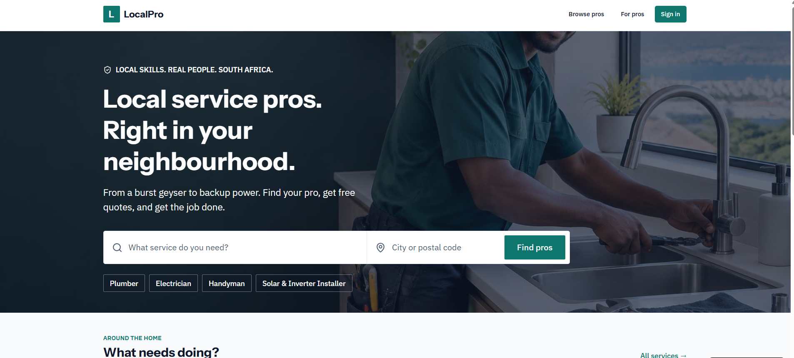
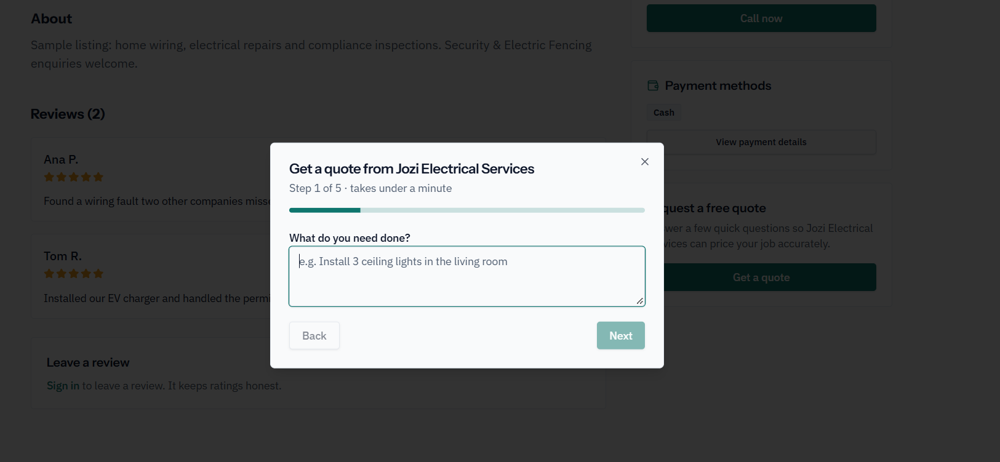
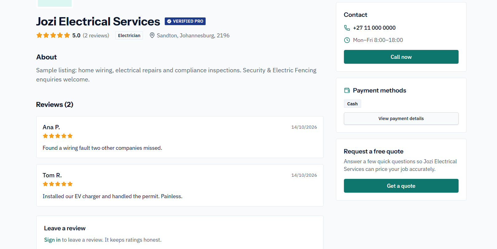

# 2. User Stories and Tasks — Evidence

[← Back to portfolio](../README.md) · [Reflection](reflection.md)

---

## US-01 — Browse Service Categories and Local Pros

> **As a** customer, **I want to** browse local service providers by category and location, **so that** I can find verified professionals in my area.

### Application Evidence

  

*Figure 1. LocalPro homepage interface showing service search input, location filtering, and category quick-links (Plumber, Electrician, Handyman, Solar Installer).*

---

## US-02 — Request a Free Quote (Quote Wizard)

> **As a** customer, **I want to** complete a step-by-step quote wizard, **so that** I can describe my job requirements and request accurate pricing from service providers.

### Application Evidence

  

*Figure 2. Step 1 of the guided quote request modal allowing customers to detail job requirements before sending.*

---

## US-03 — View Professional Profiles and Customer Reviews

> **As a** customer, **I want to** view a service provider's business listing, contact options, and verified reviews, **so that** I can assess their work quality before hiring them.

### Application Evidence

  

*Figure 3. Business profile page displaying ratings, customer reviews, contact hours, accepted payment methods, and quote call-to-action.*
