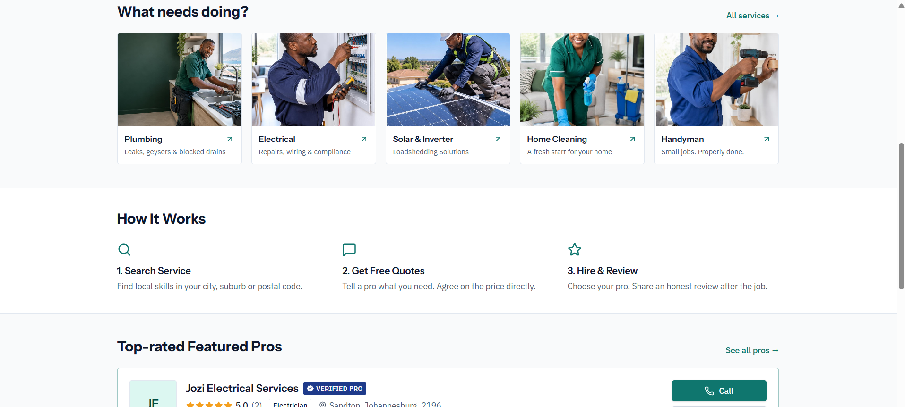

# 3. Product Backlog — Evidence

[← Back to portfolio](../README.md) · [Reflection](reflection.md)

---

## 1. Directory Search and Featured Listings Backlog

### Backlog Items
- [x] Design homepage search header with category and postal code filters.
- [x] Render featured business listings with verified "Verified Pro" badges.
- [x] Implement directory category cards (Plumbing, Electrical, Solar/Inverter, Home Cleaning, Handyman).

### Screenshot Evidence

*Figure 1. Top-rated Featured Pros section displaying category tags, ratings, locations, and direct call/quote buttons.*

---

## 2. Business Profile Management Backlog

### Backlog Items
- [x] Create business detail forms for business name, category, and service area.
- [x] Add contact fields for phone, operating hours, email, website, and social media.
- [x] Provide file upload controls for business logo and cover photo.

### Screenshot Evidence

*Figure 2. Business dashboard profile management interface with editable business fields and cover photo upload locks.*
