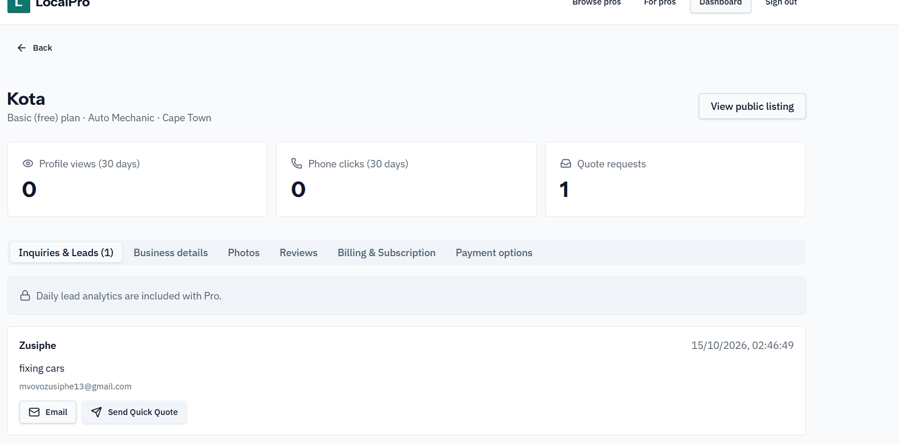
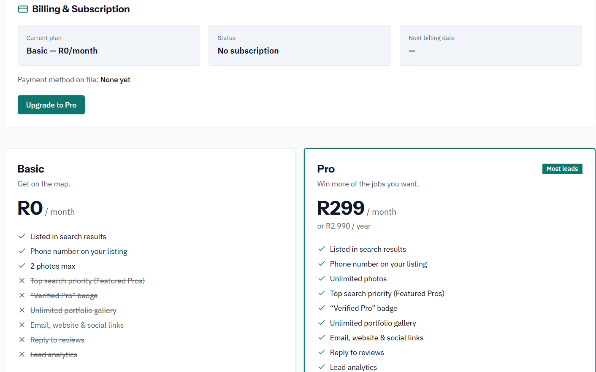
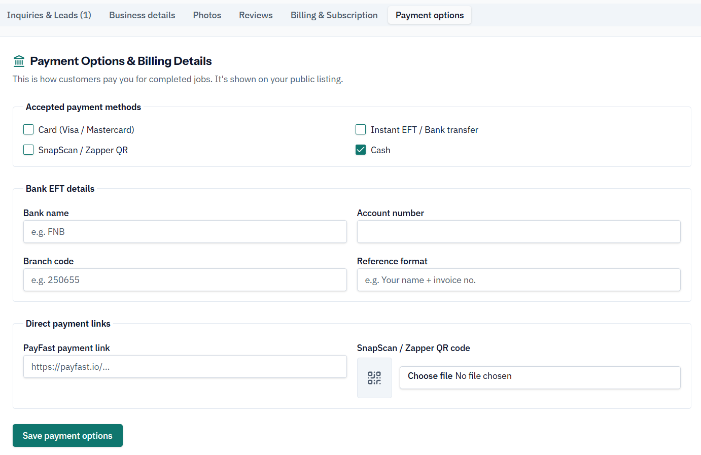

# 4. Sprint Backlog — Evidence

[← Back to portfolio](../README.md) · [Reflection](reflection.md)

---

## Sprint 1: Lead Management and Business Dashboard

**Sprint Goal:** Provide business owners with a specialized dashboard to view incoming client quote requests and lead inquiries.

### Assigned Tasks & Completed Evidence
- [x] Build inquiry list view displaying customer name, message, email, and timestamp.
- [x] Implement direct email and "Send Quick Quote" action buttons.

  

*Figure 1. Provider dashboard showing profile view metrics, quote request counters, and customer lead details.*

---

## Sprint 2: Subscription Tier Management (Basic vs Pro)

**Sprint Goal:** Build the freemium subscription engine enabling business owners to upgrade to the R299/month Pro tier for top priority listings.

### Assigned Tasks & Completed Evidence
- [x] Design plan comparison UI highlighting Basic (R0/mo) vs Pro (R299/mo) features.
- [x] Configure Pro feature toggles (unlimited photos, verified badges, top search placement, review replies).

  

*Figure 2. Billing & Subscription management page outlining free vs paid tier feature comparisons.*

---

## Sprint 3: Payment Options & Local Gateway Integration

**Sprint Goal:** Allow service providers to configure their preferred customer payment methods and PayFast links.

### Assigned Tasks & Completed Evidence
- [x] Add payment method selection (Card, Instant EFT, SnapScan/Zapper, Cash).
- [x] Integrate direct PayFast payment link inputs and QR code uploads.

  

*Figure 3. Business payment setup interface for accepted payment methods, bank EFT details, and PayFast link inputs.*
